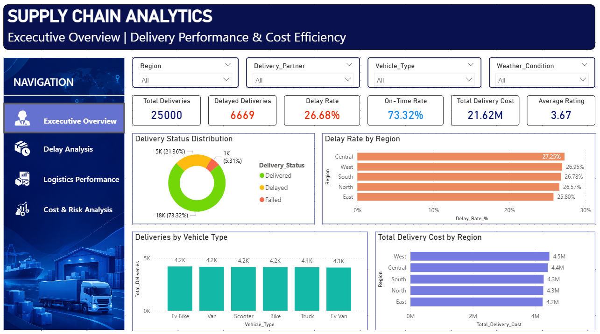

# 📊 Supply Chain Analytics Dashboard

### Power BI | DAX | Logistics Performance | Operational Analytics

An interactive four-page Power BI dashboard designed to monitor delivery performance, analyze delays, evaluate logistics operations, and explore transportation costs.

**Dashboard Version:** 1.0

**Dashboard Pages:** 4

**Tool:** Microsoft Power BI Desktop

[⬅ Back to Main Project](../README.md)

---

## 📌 Dashboard Overview

The Supply Chain Analytics Dashboard provides an interactive reporting solution for analyzing historical logistics operations.

It helps explore:

- Delivery performance
- On-time and delayed deliveries
- Delivery partner performance
- Weather-related delay patterns
- Vehicle performance
- Transportation distances
- Delivery modes
- Customer ratings
- Delivery costs
- Delay-associated transportation costs

The dashboard contains four analytical pages, each focusing on a different area of logistics performance.

---

## 🗂️ Dashboard Pages

| Page | Dashboard Name | Primary Focus |
|------|----------------|---------------|
| 01 | Executive Overview | Overall delivery and operational performance |
| 02 | Delay Analysis | Delivery delays and contributing operational factors |
| 03 | Logistics Performance | Delivery volume, distance, modes, and ratings |
| 04 | Cost & Risk Analysis | Transportation costs and delay-associated cost exposure |

---

# 📈 PAGE 1 — EXECUTIVE OVERVIEW

## 🎯 Objective

Provide a high-level overview of logistics performance through essential KPIs and interactive visualizations.

This page helps users quickly understand delivery volume, reliability, costs, and customer satisfaction.

### 📌 Key Performance Indicators

| KPI | Description |
|-----|-------------|
| Total Deliveries | Total number of delivery records |
| Delayed Deliveries | Number of delayed deliveries |
| Delay Rate | Percentage of deliveries marked as delayed |
| On-Time Rate | Percentage of deliveries completed on time |
| Total Delivery Cost | Total transportation and delivery costs |
| Average Rating | Average customer delivery rating |

### 📊 Visualizations

**1. Delivery Status Distribution**

A donut chart showing the distribution of deliveries by delivery status.

**2. Delay Rate by Region**

Compares delivery delay percentages across regions.

**3. Deliveries by Vehicle Type**

Displays delivery volume across different vehicle categories.

**4. Total Delivery Cost by Region**

Compares total transportation costs across delivery regions.

### 🎛️ Interactive Filters

- Region
- Delivery Partner
- Vehicle Type
- Weather Condition

### 🖼️ Dashboard Screenshot



---

# ⏱️ PAGE 2 — DELAY ANALYSIS

## 🎯 Objective

Analyze delivery delays across operational categories to identify patterns associated with delivery performance.

### 📌 Key Performance Indicators

| KPI | Description |
|-----|-------------|
| Delay Rate | Percentage of delayed deliveries |
| Delayed Deliveries | Total delayed delivery count |
| On-Time Rate | Percentage of on-time deliveries |

### 📊 Visualizations

**1. Delay Rate by Delivery Partner**

Compares delay percentages across delivery partners.

Helps identify partners that may require additional operational investigation.

**2. Delay Rate by Weather Condition**

Analyzes delivery delay percentages under different weather conditions.

**3. Delay Rate by Vehicle Type**

Compares delay percentages across transportation vehicle categories.

**4. Delay Rate by Distance Band**

Examines how delivery delay percentages vary across delivery distance ranges.

### 🎛️ Interactive Filters

- Region
- Delivery Partner
- Vehicle Type
- Weather Condition

### 🖼️ Dashboard Screenshot


---

# 🚛 PAGE 3 — LOGISTICS PERFORMANCE

## 🎯 Objective

Evaluate operational logistics performance across delivery partners, transportation vehicles, delivery modes, and regions.

### 📌 Key Performance Indicators

| KPI | Description |
|-----|-------------|
| Total Deliveries | Total delivery volume |
| Average Distance | Average delivery distance |
| Average Rating | Average customer rating |

### 📊 Visualizations

**1. Total Deliveries by Delivery Partner**

Compares the number of deliveries handled by each delivery partner.

**2. Average Delivery Distance by Vehicle Type**

Analyzes average transportation distances across vehicle categories.

**3. Delivery Volume by Delivery Mode**

Shows delivery counts across different delivery modes.

**4. Average Delivery Rating by Region**

Compares average customer delivery ratings across regions.

### 🎛️ Interactive Filters

- Region
- Delivery Partner
- Vehicle Type
- Delivery Mode

### 🖼️ Dashboard Screenshot


---

# 💰 PAGE 4 — COST & RISK ANALYSIS

## 🎯 Objective

Analyze transportation costs, compare cost efficiency, and understand the share of delivery expenses associated with delayed deliveries.

### 📌 Key Performance Indicators

| KPI | Description |
|-----|-------------|
| Total Delivery Cost | Total cost associated with deliveries |
| Average Delivery Cost | Average cost per delivery |
| Cost Per Kilometer | Delivery cost relative to transportation distance |
| Delayed Cost Share | Percentage of total delivery cost associated with delayed deliveries |

### 📊 Visualizations

**1. Average Delivery Cost by Mode**

Compares average transportation costs across delivery modes.

**2. Cost Per Kilometer by Vehicle Type**

Analyzes transportation cost efficiency across vehicle categories.

**3. Average Delivery Cost by Region**

Compares average delivery costs across regions.

**4. Delivery Cost Distribution by Delay Flag**

A donut chart displaying the distribution of total delivery costs between delayed and non-delayed deliveries.

### 🎛️ Interactive Filters

- Region
- Delivery Partner
- Vehicle Type
- Delivery Mode

### 🖼️ Dashboard Screenshot


### Important Note

The term "Risk" in this dashboard refers to descriptive analysis of delay-associated transportation costs.

It does not represent machine learning prediction probabilities or live risk scores.

---

# 🧮 DAX Measures

The dashboard uses DAX measures to calculate logistics performance indicators.

### Delivery Performance

| Measure | Purpose |
|---------|---------|
| Total_Deliveries | Counts total deliveries |
| Delayed_Deliveries | Counts delayed deliveries |
| Delay_Rate_% | Calculates delayed delivery percentage |
| On-Time_Rate_% | Calculates on-time delivery percentage |

### Logistics Performance

| Measure | Purpose |
|---------|---------|
| Average_Distance | Calculates average delivery distance |
| Average_Rating | Calculates average customer rating |

### Cost Analysis

| Measure | Purpose |
|---------|---------|
| Total_Delivery_Cost | Calculates total delivery cost |
| Average_Delivery_Cost | Calculates average delivery cost |
| Cost_Per_Kilometer | Measures transportation cost per kilometer |
| Delayed_Delivery_Cost_Share_% | Calculates the share of total delivery cost associated with delayed deliveries |

These measure names are referenced by the dashboard visuals.

---

# 🎛️ Dashboard Interactivity

The Power BI dashboard includes interactive reporting features.

### 1. Navigation Sidebar

A left-side navigation area allows users to switch between the four dashboard pages.

### 2. Dynamic Slicers

Users can filter dashboard information based on available categories such as:

- Region
- Delivery Partner
- Vehicle Type
- Weather Condition
- Delivery Mode

### 3. Interactive Visualizations

Dashboard visuals support interactive exploration of logistics data.

### 4. Tooltips

Selected charts display additional operational information when users hover over visual elements.

---

# 🛠️ Technology Stack

| Technology | Purpose |
|------------|---------|
| Power BI Desktop | Dashboard development |
| Power Query | Data preparation |
| DAX | KPI calculations |
| Excel / CSV | Reporting data |
| GitHub | Project documentation and version control |

---

# 📁 Visualization Folder Structure

```text
Visualization/
│
├── README.md
│
├── data/
│   └── Reporting datasets
│
├── PowerBI_File/
│   └── Supply_Chain_Analytics_Dashboard.pbix
│
└── Screenshots/
    ├── Executive_Overview.png
    ├── Delay_Analysis.png
    ├── Logistics_Performance.png
    └── Cost_and_Risk_Analysis.png
```

---

# 🚀 How to Open the Dashboard

### Step 1

Download the Power BI dashboard file from:

`PowerBI_File/Supply_Chain_Analytics_Dashboard.pbix`

### Step 2

Open the downloaded file using Microsoft Power BI Desktop.

### Step 3

If Power BI cannot locate the original data files, update the data source paths and refresh the report.

### Step 4

Use the navigation sidebar to explore the four analytical pages.

### Step 5

Apply slicers and interact with charts to explore logistics performance.

---

# 💡 Business Value

The dashboard supports logistics performance monitoring by helping users:

- Track delivery reliability
- Compare delivery partner performance
- Investigate delay patterns
- Analyze vehicle performance
- Monitor delivery costs
- Explore customer ratings
- Identify areas requiring operational investigation

The dashboard provides descriptive insights based on historical logistics records.

---

# 🔮 Future Enhancements

Planned improvements include:

### 1. Prediction Analysis Dashboard

Develop a dedicated visualization page using prediction outputs generated by the Python machine learning workflow.

Potential features:

- Predicted delayed deliveries
- Predicted on-time deliveries
- Delay-risk distribution
- Prediction confidence, where supported
- Risk analysis by operational category

### 2. Advanced Dashboard Features

- Improved visual interactions
- Additional operational KPIs
- Enhanced tooltips
- More detailed business insights
- Refined dashboard design

### 3. Model Integration

Explore ways to connect verified machine learning prediction outputs with Power BI reporting.

---

# ⚠️ Current Dashboard Scope

The current Version 1 dashboard focuses on descriptive logistics analytics.

Delivery delay prediction has been developed separately in Python.

Machine learning predictions are not yet integrated into the Power BI dashboard.

The dashboard is an analytics portfolio project rather than a live operational logistics system.

---

## 🔗 Main Project

For Python data analysis, machine learning development, project workflow, and complete project documentation:

**[View Main Project README](../README.md)**

---

### ⭐ Built With

**Power BI • DAX • Logistics Analytics • Business Intelligence • Data Visualization**